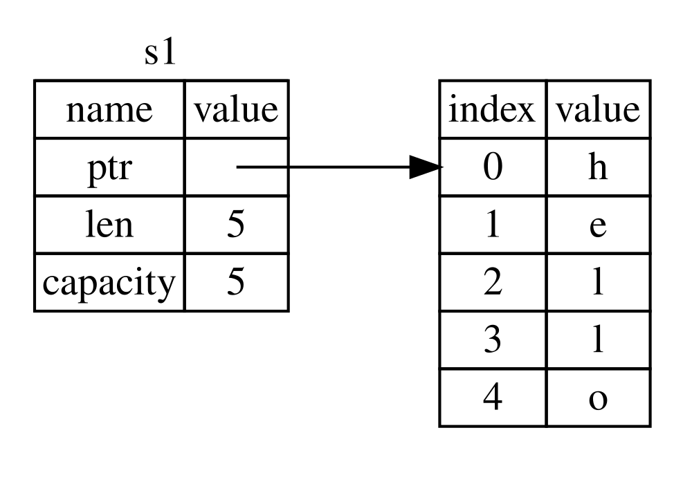

# 所有权：谁负责释放数据

先记住三条规则：每个值都有所有者；一个值同一时刻只有一个所有者；所有者离开作用域时，值会被清理。Rc 等类型通过共享句柄管理同一份数据，后面再讲。

## 移动和复制

String 拥有一段堆上的文本。把它赋给另一个变量，通常会转移所有权，叫移动。

```rust,compile_fail
let first = String::from("hello");
let second = first;
println!("{first}"); // 所有权已交给 second，不能再使用 first。
```

如果真的需要两份独立文本，显式调用 clone：

```rust
let first = String::from("hello");
let second = first.clone();
assert_eq!(first, second); // 内容相同，分别拥有自己的数据。
```

整数、bool 等实现了 Copy，赋值时复制，不会让旧变量失效。String 没有实现 Copy。Copy 是一种类型能力，不能只看数据大小判断。

## 函数也会接过所有权

```rust
fn length(text: String) -> usize {
    text.len()
} // text 在这里释放。
let name = String::from("Rust");
let size = length(name);
assert_eq!(size, 4);
// 此后不能再用 name。
```

返回一个拥有数据的值，会把所有权交给调用者。如果函数只需要读数据，不想拿走它，改用引用。

## 栈和堆

栈按函数调用和作用域管理局部数据；堆适合动态分配。String 本身保存地址、长度、容量，文本字节在堆上。移动 String 时通常转移这些管理信息，不会复制整段文本。



图中的具体布局用于理解，不应当成所有类型都适用的规则。Rust 的所有权系统决定谁负责清理数据。

[返回目录](SUMMARY.md)
