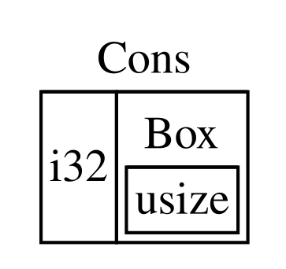

# Box：一个所有者，管理堆上的数据

Box 把值放在堆上，自己负责释放。移动 Box 会转交所有权，不会自动复制内部数据。

```rust
let value = Box::new(5);
assert_eq!(*value, 5);
```

## 为什么递归类型需要它

如果 List 直接包含另一个 List，编译器没法算出大小。改成 Box 后，这个间接指针的大小可以确定。

```rust
enum List {
    Cons(i32, Box<List>),
    Nil,
}
impl List {
    fn sum(&self) -> i32 {
        match self {
            Self::Cons(value, next) => value + next.sum(),
            Self::Nil => 0,
        }
    }
}
let list = List::Cons(1, Box::new(List::Cons(2, Box::new(List::Nil))));
assert_eq!(list.sum(), 3);
```



Box 还常用于转移较大数据的所有权，或通过 `Box<dyn Trait>` 保存实现相同能力的不同具体类型。它不会绕过借用规则，也不会自动提供多个所有者。

[返回目录](SUMMARY.md)
