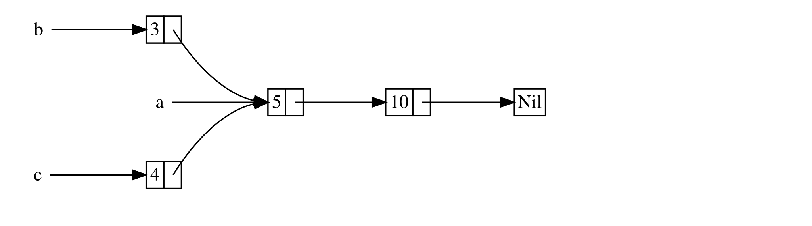

# Rc：让多个所有者共享一份数据

一个值需要被多个地方共同拥有时，可以用 Rc。每多一个强引用就增加计数，最后一个强引用释放时销毁内部值。

```rust
use std::rc::Rc;
let first = Rc::new(vec![1, 2, 3]);
let second = Rc::clone(&first);
assert_eq!(Rc::strong_count(&first), 2);
assert!(Rc::ptr_eq(&first, &second));
drop(second);
assert_eq!(Rc::strong_count(&first), 1);
```

`Rc::clone` 只创建新的共享句柄，不深拷贝内部 Vec。写成 `first.clone()` 对 Rc 也一样，只是显式写 Rc::clone 更容易看出意图。



Rc 的共享访问不能直接修改普通内部值。需要修改时可结合 RefCell；只有唯一强引用且没有 Weak 时，Rc::get_mut 才能提供独占的可变引用。

Rc 只适合单线程，计数操作不是跨线程同步操作。需要跨线程共享所有权时使用 Arc，再按需求搭配锁等同步工具。

[返回目录](SUMMARY.md)
