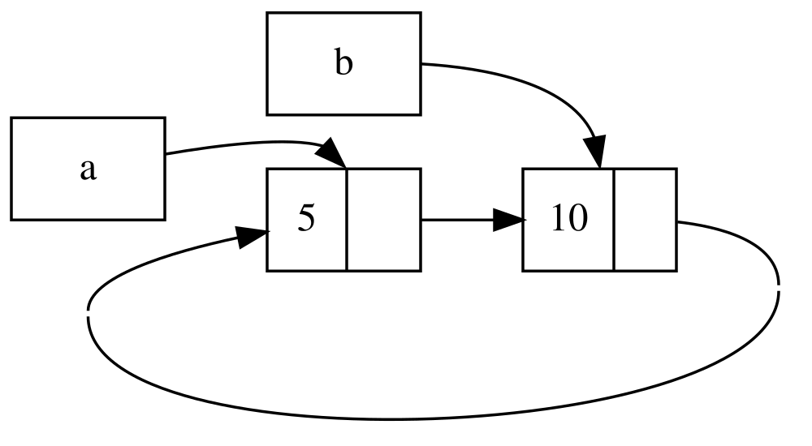

# Weak：别让相互引用变成泄漏

如果 a 用 Rc 拥有 b，b 又用 Rc 拥有 a，外部引用都释放后，双方仍互相保持强引用，内部值就不会销毁。这种内存泄漏也可能出现在安全 Rust 中。



树结构通常这样设计：父节点用 Rc 拥有子节点，子节点用 Weak 回指父节点。回指只是为了查找，不负责延长父节点寿命。

```rust
use std::rc::Rc;
let owner = Rc::new(String::from("父节点"));
let weak = Rc::downgrade(&owner);
assert_eq!(Rc::strong_count(&owner), 1);
assert!(weak.upgrade().is_some());
drop(owner);
assert!(weak.upgrade().is_none());
```

`Rc::downgrade` 创建弱引用，不增加强引用计数。`upgrade()` 在目标仍存活时返回 `Some(Rc<T>)`，否则返回 None。成功返回的 Rc 会暂时延长目标寿命。

强引用归零后内部值销毁；只要 Weak 还在，引用计数所需的分配可能仍保留。不要递归打印环形结构，否则可能无限递归并栈溢出。

完整父子树和主动断环示例见[项目智能指针说明](../smart_pointers.md)。

[返回目录](SUMMARY.md)
